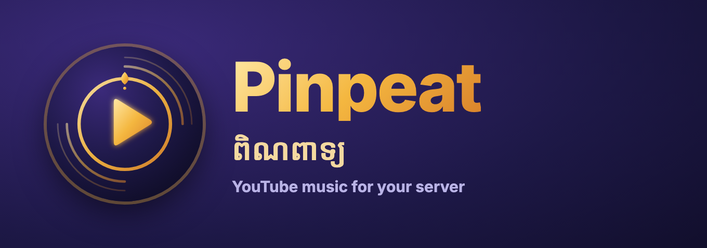

# Pinpeat ពិណពាទ្យ



**A self-hosted Discord music bot for YouTube.** Type `/play`, pick a song from the suggestions, and it plays in your voice channel.
It streams instead of downloading, so 1-hour or 5-hour videos start in a few seconds, and `/seek 2:30:00` jumps anywhere inside them.

Named after the *pinpeat* (ពិណពាទ្យ), the Khmer classical orchestra.

> Run it for your own servers. Big public YouTube bots (Groovy, Rythm) were shut down for breaking YouTube's terms.

## Features

- **Slash commands with suggestions**: `/play` shows the top 5 YouTube results (length · title) while you type. The `!` prefix commands work too.
- **Long videos**: streaming plus `/seek 1:23:45`, `/seek 2h10m`, `/seek +10m`, `/seek -30s`.
- **Queue and playlists**: paste a playlist link (up to 200 tracks), `/queue`, `/skip`, `/remove`, `/loop`, `/volume`.
- **Many servers at once**: each server gets its own queue, volume and voice channel.
- **Optional YouTube sign-in** with your own cookies (Premium: better audio when offered, age-restricted and members-only videos).
- **Says when it's online**: posts "🟢 Pinpeat is online!" in `#general` when it starts (turn off with `ANNOUNCE=0`).
- **Good sound**: plays YouTube's best audio (Opus ~130-160 kbps, 48 kHz) through yt-dlp, starting at 100% volume.
- **Works on cloud servers**: seeking uses YouTube's `tv_simply` client; if one way gets a 403 from YouTube, it tries the other.
- Leaves the voice channel after 5 idle minutes.

## Commands

| Slash | Prefix | What |
|---|---|---|
| `/play <link / playlist / words>` | `!play`, `!p` | play now or add to the queue |
| `/seek <time>` | `!seek` | jump: `1:23:45`, `2h10m`, `+10m`, `-30s` |
| `/now` | `!np` | now playing with a progress bar |
| `/queue` · `/skip` · `/pause` · `/resume` | `!q` · `!s` · ... | queue control |
| `/remove <n>` · `/clear` | | edit the queue |
| `/volume 0-150` · `/loop` | `!vol` | volume, repeat the current song |
| `/stop` | `!leave` | clear the queue and leave |
| `/login` | | check the YouTube sign-in |
| `/help` | | all commands |

## Setup

### 1. Create the Discord bot

1. Go to <https://discord.com/developers/applications>, click **New Application**, and name it (e.g. Pinpeat).
   You can use `assets/pinpeat-avatar.png` as the icon and `assets/pinpeat-banner.png` as the banner.
2. On the **Bot** page:
   - Turn on **Message Content Intent** (needed for `!` commands).
   - Leave **Requires OAuth2 Code Grant** off.
   - Turn **Public Bot** off if only you should be able to invite it.
   - Click **Reset Token** and copy the token. Treat it like a password.
3. Invite the bot with this link (replace `APP_ID` with the Application ID from **General Information**):
   ```
   https://discord.com/oauth2/authorize?client_id=APP_ID&scope=bot&permissions=3214400
   ```
   (View Channels, Send Messages, Add Reactions, Read Message History, Connect, Speak.) The bot also prints this link when it starts.

Leave the Interactions Endpoint URL, Linked Roles, Terms of Service and Privacy Policy URL fields empty.

### 2. Configure

```bash
git clone https://github.com/MuyleangIng/pinpeat.git && cd pinpeat
cp .env.example .env      # put DISCORD_TOKEN in it
```

| Variable | Default | Meaning |
|---|---|---|
| `DISCORD_TOKEN` | (required) | bot token |
| `YT_COOKIES` / `YT_BROWSER` | (none) | YouTube sign-in: a `cookies.txt` path, or a browser name (`chrome`, `firefox`, `safari`...) |
| `PREFIX` | `!` | prefix for text commands |
| `ANNOUNCE` / `ANNOUNCE_CHANNEL` | `1` / `general` | post "online" when the bot starts, and where |
| `ALLOWED_GUILDS` | (all) | comma-separated server IDs the bot answers in |
| `IDLE_LEAVE_S` | `300` | leave voice after this many idle seconds |
| `MAX_PLAYLIST` | `200` | max tracks taken from a playlist link |
| `QUALITY` | `high` | `high` = best audio via yt-dlp (songs start ~5 s slower); `normal` = direct link, faster start |
| `YT_CLIENTS` | `tv_simply,default` | YouTube clients tried for the direct link |

### 3. Run

You need **Python 3.10+**, **FFmpeg**, and **deno** (yt-dlp uses it for YouTube's player checks). [uv](https://docs.astral.sh/uv/) makes it one command:

```bash
uv run bot.py
```

**Important: the bot's network must allow outgoing UDP.** Discord voice uses UDP. On networks that block it (some university or office networks), the bot reads commands but times out joining voice. In that case, run it on a home connection or a small cloud server.

#### Always on: Linux server (systemd)

From your computer, set up `deploy.env` (see the top of `cloud.sh`; it works with plain `ssh` or `gcloud compute ssh`), then:

```bash
./cloud.sh install   # copies bot.py/.env/cookies.txt, installs FFmpeg, uv, deno, venv, systemd service
./cloud.sh deploy    # after editing bot.py, .env or cookies.txt
./cloud.sh status | logs | restart | update | stop
```

Or, on the server itself, put `bot.py`, `.env` and `deploy/` in a folder and run `bash deploy/install_linux.sh`.

#### Always on: Mac (LaunchAgent)

```bash
brew install ffmpeg deno uv
./pinpeat.sh start    # starts at login, restarts on crash; logs in ~/Library/Logs/pinpeat/bot.log
./pinpeat.sh status | logs | restart | update | stop
```

## YouTube sign-in (optional)

Without cookies, normal public videos play fine. To sign in:

1. In a **private window**, sign in to youtube.com with the account.
2. Export the cookies with a "Get cookies.txt LOCALLY" browser extension, save as `cookies.txt` next to `bot.py`, and set `YT_COOKIES=cookies.txt`.
3. Close the private window **without signing out** (signing out kills the cookies).
4. Restart the bot and run `/login`. It should say ✅.

A `cookies.txt` gives full access to that Google account (not only YouTube). Keep it private, and consider a separate account for the bot.

## Troubleshooting

| Symptom | Cause / fix |
|---|---|
| Bot joins voice, green ring shows, but **no sound** | `davey` 0.2.0 doesn't work with discord.py 2.7.1's voice encryption (discord.py#10557). Keep `davey>=0.1,<0.2` (already pinned here). |
| "Can't reach Discord voice" / times out joining | the network blocks outgoing UDP; move the bot |
| `PrivilegedIntentsRequired` at start | turn on **Message Content Intent** in the Developer Portal |
| "Sign in to confirm you're not a bot" | add cookies (above), or `./cloud.sh update` for the newest yt-dlp |
| HTTP 403 in the log | YouTube blocking the stream link; the bot retries through yt-dlp. Update yt-dlp if it keeps happening. |
| `/` commands don't show | wait a few minutes after the first start, or restart the Discord app |

## Sound quality

The bot sends 128 kbps Opus, but each Discord voice channel has its own bitrate (64 kbps by default).
For music, raise it: **Edit Channel → Bitrate → 96 kbps** (higher needs Server Boost).

## Files

| File | What |
|---|---|
| `bot.py` | the bot (discord.py + yt-dlp) |
| `.env.example` | settings template |
| `cloud.sh`, `deploy/` | install and manage on a Linux server (systemd) |
| `pinpeat.sh` | run on a Mac as a LaunchAgent |
| `assets/` | logo, banner, and `make_logo.py` that draws them |

## License

MIT. See [LICENSE](LICENSE). You are responsible for how you use it with YouTube and Discord (their terms apply).
